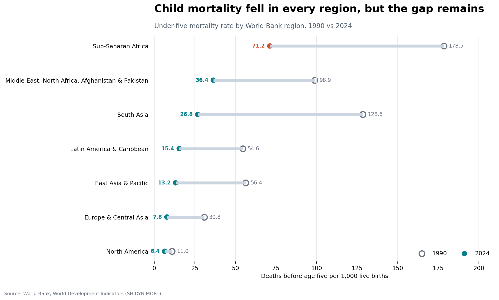
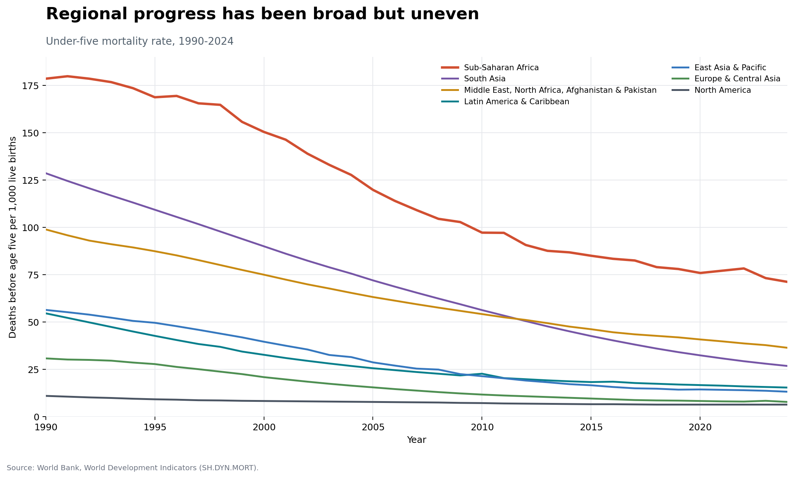

# Global Child Mortality: Progress and Persistent Gaps

## Research question

How did under-five mortality change across seven World Bank regions between 1990 and 2024, and which regional disparities remained in 2024?

## Data source and permission

The saved dataset is a response from the [World Bank Indicators API](https://api.worldbank.org/v2/country/EAS;ECS;LCN;MEA;NAC;SAS;SSF/indicator/SH.DYN.MORT?format=json&per_page=20000), indicator `SH.DYN.MORT` (under-five deaths per 1,000 live births). The API response reports a last update of 13 July 2026. World Bank Open Data is available under the [Creative Commons Attribution 4.0 licence](https://datacatalog.worldbank.org/public-licenses#cc-by). Attribution is included in the figures and documentation.

## Methods and tools

Python, pandas, and Matplotlib are used to parse the saved JSON response, select seven regional aggregates, calculate percentage declines, and produce a 1990-versus-2024 comparison plus a full trend chart. Keeping the API response in `data/` makes the result reproducible even if the live API later changes.

## Key findings

- Under-five mortality fell in all seven regions between 1990 and 2024.
- Sub-Saharan Africa recorded a decline of about 60%, from 178.5 to 71.2 deaths per 1,000 live births.
- The 2024 rate in Sub-Saharan Africa remained about 11 times the North American rate (6.4), showing that large geographic inequality persisted despite broad progress.

## Limitation

The analysis uses regional aggregates. They hide variation between countries and within-country inequalities, and the indicator is a modeled estimate rather than a complete count of every death.

## Reproduce the analysis

Requires Python 3.10 or newer.

```bash
python -m venv .venv
# Windows PowerShell
.venv\Scripts\Activate.ps1
python -m pip install -r requirements.txt
python analysis.py
```

The script writes two PNG figures and a summary CSV to `visualizations/`.

## Visualizations

### 1990 compared with 2024



Every region improved, but the distance between the highest- and lowest-rate regions remains substantial.

### Change over time



The long-run view shows broad declines rather than a one-year anomaly and highlights that regional convergence is incomplete.

## Repository structure

```text
.
|-- analysis.py
|-- data/
|   `-- worldbank_child_mortality.json
|-- visualizations/
|   |-- regional-comparison.png
|   |-- regional-trends.png
|   `-- regional-summary.csv
|-- requirements.txt
`-- README.md
```

No passwords, API keys, personal records, or restricted datasets are included.
